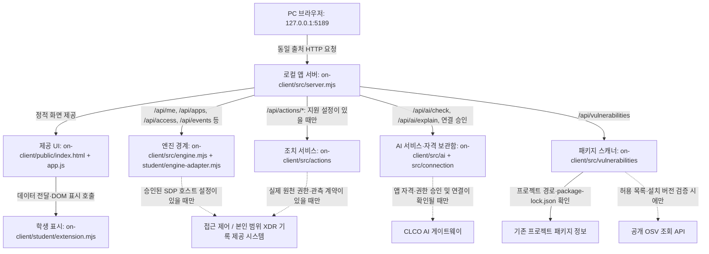

# 은셰브 — 학생용 실행 설명서 및 시스템 구성도 (21단계)

> **기준 소스:** `BoatingDuck/choi-bujang-secret-vault`, `main` 커밋 `ae427bef31a8538a391e55cc799566696695c396` (2026-10-29 조회). 이 문서는 **`on-client` 로컬 개발용 앱**을 설명한다. 작성 시 GitHub의 파일·함수·설정 견본을 읽어 대조했으며, 이 문서 작성 과정에서는 학생 PC에서 명령을 실행하거나 브라우저를 조작하지 않았다. 이후 사용자 PC에서 직접 확인한 결과는 7장에 별도로 기록했다.
>
> **이름 구분:** 학생이 부르는 보안 Agent 이름은 **은셰브**다. 현재 제공 코드의 `public/index.html`, `src/server.mjs`, `tools/start-alekov.ps1`에는 기본 표시 문구 **케셰브**가 남아 있다. 포털에서 이름을 정해도 코드의 기본 문구가 자동 변경되는 것은 아니다. 명령의 파일명이나 제공 코드를 이름에 맞춰 바꾸지 않는다.

## 1. 목적, 기능, 제공/학생 구현 경계

은셰브는 로컬 브라우저에서 사용자·기기·세션 상태, 업무 앱 접근 판정, 본인 범위의 접근·XDR 기록, AI 연결·사건 설명, 사용자 확인을 거치는 조치 결과, 설치 패키지 취약점 조회 상태를 확인하도록 구성된 교육용 보안 Agent다. **브라우저에서 어떤 카드가 표시되는 것과 실제 기업 보안 시스템 연결·조치 성공은 다르다.** 기본 실행은 실제 SDP/접근 제어 엔진과 연결되지 않으며 `-Demo`는 예제 자료다.

- **제공 영역(변경하지 않음):** `on-client/public/index.html`, `on-client/public/app.js`, `on-client/public/ai-connect.mjs`, `on-client/public/vulnerabilities-view.mjs`, `on-client/public/pc-status-view.mjs`, `on-client/src/server.mjs` 및 `src/`의 연결·엔진·AI·조치·OSV 모듈. 탭, 카드, HTTP 통신, 인증/검증, API 요청, 조치 접수 및 응답 판정은 제공 코드 경계다.
- **학생 작성 영역(기존 구현 보존):** `on-client/student/extension.mjs`의 `createStudentView()`가 반환하는 8개 `render*` 표시 함수. 이 함수는 제공 화면에서 전달받은 조회/판정 상태를 DOM 노드 또는 텍스트로 표시한다. 실제 엔진 자격, 서버 권한, AI 키, XDR 운영자 데이터나 집행 권한을 만들지 않는다.
- **학생 문서(이번 단계 신규):** `on-client/docs/STUDENT_RUNBOOK.md`(이 파일). 이전 단계의 학생 코드와 개발 로그를 수정하지 않는다.
- **연결 경계:** `student/engine-adapter.mjs`는 기본 `disconnected`를 반환한다. 담당자가 승인한 SDP 호스트를 명시적으로 연결할 때만 호스트의 본인 범위 `readIdentity`, `readApps`, `decideAccess` 및 지원되는 조회 기능을 중계한다. 미지원 함수를 가짜 성공이나 빈 결과로 바꾸지 않는다.

## 2. 필요 프로그램·버전·지원 범위

| 항목 | 코드·문서로 확인한 사실 | 학생 PC에서 실제 버전 확인 |
|---|---|---|
| OS / 셸 | 제공 실행 도구 `tools/start-alekov.ps1`은 Windows PowerShell 및 Windows 경로·프로세스 기능 사용 | **확인:** Windows PowerShell `5.1.26100.9711` |
| Node.js | `on-client/package.json`의 `engines.node`는 **`24.19.0`**. 실행 스크립트는 메이저 **22~24**를 허용하고 `24.19.0`을 수업 기준으로 안내 | **확인:** `v24.19.0` |
| npm | Node.js 설치와 함께 사용하는 `npm` 명령. `on-client/package.json`에 `start`, `demo`, `check`, `package-app` 정의 | **확인:** `11.17.0` |
| 시작 틀 버전 | `on-client/package.json`은 **`0.2.19`**, `on-client/README.md` 제목도 **`0.2.19`** | 파일 대조 완료, 실행 버전 검증은 미확인 |
| 다른 위치의 프로젝트 | 저장소 최상위 `package.json`은 **별도** `aleph-defense-starter` (`node >=22`, `package-lock.json`, 의존성 포함). 1~3차/기존 프로젝트 소스이며 **4차 `on-client`의 실행 폴더가 아님** | 코드로 구분 완료 |
| 외부 npm 패키지 설치 | `on-client/package.json`에는 `dependencies`와 `devDependencies`가 없고 `on-client/package-lock.json`도 이 기준 커밋에 없음. 로컬 앱 실행을 위해 `npm ci`나 `npm install`을 수행하도록 안내하지 않음 | 설치 명령 미실행 |
| 브라우저 | PC 브라우저에서 `http://127.0.0.1:5189/` 사용. 특정 브라우저/버전의 동작 보증은 하지 않음 | **로컬 브라우저 접속 확인** (브라우저 종류·버전 미확인) |
| SDP·AI 게이트·조치·OSV | 실제 사용은 운영자 설정·계정 승인·연결 상태·공개 패키지 허용 목록에 따라 달라짐. 시작 틀만으로 연결된 것으로 간주하지 않음 | 이 문서 작성 시 실제 외부 연결/유료 AI 요청/조치 집행 **미실행** |

**버전 주의:** `GET /api/diagnostics` 응답의 `component: 'on-client', version: '0.1.0'`은 서버 진단 응답의 고정 식별 값이다. 현재 `on-client/package.json`의 앱 버전 `0.2.19`와 동일한 의미로 사용하지 않는다.

## 3. 실제 작업 위치와 폴더 구조

이전에 작업하던 Windows 프로젝트 경로는 `C:\Users\User\choi-bujang-secret-vault`였다. 현재 PC의 실제 폴더는 아래 `Get-Location`과 `Test-Path`로 다시 확인한다. **Git 커밋은 저장소 최상위**, 앱 실행은 그 안의 **`on-client` 폴더**에서 수행한다.

```text
choi-bujang-secret-vault/                   ← Git 저장소 최상위 (커밋 위치)
├─ README.md, package.json, package-lock.json  ← 기존 프로젝트: 수정/실행 대상 아님
├─ api/, src/, public/, xdr/, docs/             ← 기존 단계 소스: 보존
└─ on-client/                                ← 21단계 앱 폴더 (실행 위치)
   ├─ README.md                              ← 제공 시작 안내 + 학생 21단계 링크/요약
   ├─ package.json                          ← 0.2.19, start/demo/check/package-app
   ├─ .env.example                          ← 공개 가능한 설정 견본 (비밀값 없음)
   ├─ tools/start-alekov.ps1                ← 로컬 앱 실행·폴더/버전/포트 확인
   ├─ src/server.mjs                        ← 127.0.0.1 HTTP 서버·API
   ├─ src/engine.mjs                        ← 연결 어댑터 로딩·예제 엔진
   ├─ src/ai/, src/actions/, src/vulnerabilities/
   ├─ student/extension.mjs                 ← 학생 구현 8개 렌더 함수
   ├─ student/engine-adapter.mjs            ← 실제 엔진 권한을 만드는 파일 아님
   ├─ public/index.html, public/app.js     ← 제공 탭·카드·학생 함수 호출
   └─ docs/
      ├─ STUDENT_RUNBOOK.md                ← 이 문서 (21단계 신규)
      ├─ STUDENT_LAUNCH_GUIDE.md           ← 제공 실행 안내 (유지)
      ├─ IMPLEMENTATION_CONTRACT.md         ← 제공 API 계약 (유지)
      ├─ CONNECTION_TROUBLESHOOT.md        ← 제공 오류 코드 안내 (유지)
      └─ development-log/                   ← 이전 단계 기록 (유지)
```

## 4. 새 PowerShell에서 시작 → 확인 → 종료 → 재실행

아래는 **PC에서 사용자가 직접 수행할 실행 절차**다. 문서 작성자가 대신 실행했다고 주장하지 않는다. 기존 실행 창이나 다른 앱 프로세스를 강제로 종료하지 않는다.

**① 새 PowerShell 열기 및 위치 확인**

파일 탐색기에서 `C:\Users\User\choi-bujang-secret-vault\on-client`를 열고 주소 표시줄에 `powershell`을 입력해 새 창을 연다. 또는 새 PowerShell에서 아래를 실행한다. 해당 경로가 없다면 실제 프로젝트 위치로 변경한다.

```powershell
Set-Location "$HOME\choi-bujang-secret-vault\on-client"
Get-Location
Test-Path .\package.json
Test-Path .\src\server.mjs
Test-Path .\student\extension.mjs
Test-Path .\tools\start-alekov.ps1
node --version
npm.cmd --version
$PSVersionTable.PSVersion
```

`Test-Path` 네 항목이 모두 `True`이고 현재 경로가 `...\on-client`인지 확인한다. `node --version`의 실측 값을 기록한다. 코드 기준 수업 버전은 `v24.19.0`이지만 확인 전에는 그렇게 설치돼 있다고 쓰지 않는다.

**② 실행(기본 제공 명령)**

```powershell
powershell -NoProfile -ExecutionPolicy Bypass -File .\tools\start-alekov.ps1
```

이 명령은 사전 검사를 하고, `node src/server.mjs`에 해당하는 앱 서버를 켠다. 기본 모드에서는 개인 계정 연결 설정을 Windows 사용자 폴더에 준비할 수 있으나, **이것만으로 인증·AI 연결이 완료되지 않는다.** 실행 도구는 학생 프로그램을 새로 설치하거나 다른 포트의 프로그램을 종료하지 않는다. 기본 도구 대신 `npm start`도 `on-client` 안에서 서버를 켜지만 사전 Node 버전·포트 검사가 없다. PowerShell의 `npm.ps1` 실행 정책 오류가 나면 위 `powershell ... -File` 방식 또는 `npm.cmd start`를 사용한다.

연결 설정을 만들지 않고 **로컬 화면만 확인**하려면 다음 별도 명령을 선택할 수 있다(동시에 실행하지 않음).

```powershell
powershell -NoProfile -ExecutionPolicy Bypass -File .\tools\start-alekov.ps1 -NoNativeHost
```

예제 기능을 분리해 관찰할 때만 아래처럼 실행하며, 이는 **실제 접속·XDR·AI 연결을 검증하지 않는다**.

```powershell
powershell -NoProfile -ExecutionPolicy Bypass -File .\tools\start-alekov.ps1 -Demo
```

**③ 정상 시작 신호 및 브라우저 주소**

실행 도구가 정상 응답을 확인하면 다음 문구를 출력하도록 작성돼 있다. 실제 출력이 나왔는지는 직접 확인한다.

```text
케셰브가 켜졌습니다. 브라우저에서 http://127.0.0.1:5189/ 을 여세요.
서버가 응답한 것만 확인했습니다. AI 연결 상태는 화면에서 따로 확인해 주세요.
끄려면 이 창에서 Ctrl+C 를 누르세요.
```

PC 브라우저에서 **`http://127.0.0.1:5189/`**로 접속한다. 제공 화면의 탭은 **「보호 현황」, 「업무 앱」, 「보안 기록」**이다. 보호 현황의 **「현재 로그인」, 「AI 연결」, 「AI 연결 점검」, 「설치 패키지와 취약점 정보」**, 업무 앱의 **「접속 요청」·「판정 결과」**, 보안 기록의 **「접속·XDR 기록」**을 코드의 실제 이름과 대조한다. 시작 신호는 HTTP 200 확인이지 외부 연결 완료 표시가 아니다. 연결이 없다면 `disconnected`/`ENGINE_NOT_CONNECTED` 등 상태를 정상 연결이라고 적지 않는다.

**④ 종료와 재실행**

실행한 **같은 PowerShell 창에서 `Ctrl+C`**를 눌러 종료한다. 종료 후 `http://127.0.0.1:5189/`에 새로 접속했을 때 기존 앱 서버가 응답하지 않는지 확인한다(다른 프로세스가 포트를 점유했다면 따로 구분). 같은 `on-client`에서 ②의 **동일한 명령**을 다시 실행하고 ③의 브라우저 페이지를 새로고침한다. 기본 접속 주소가 충돌하면 **기존 프로그램을 종료하지 말고** 다음 별도 실행을 사용한다.

```powershell
powershell -NoProfile -ExecutionPolicy Bypass -File .\tools\start-alekov.ps1 -Port 5190
```

이 경우 주소도 `http://127.0.0.1:5190/`으로 바뀐다. **`-Background`는 창 없이 실행되므로 위 `Ctrl+C` 종료 절차와 다르다**. 재현 확인은 기본 전경 실행을 사용한다.

## 5. 글로 작성한 시스템 구성도 (Mermaid + 연결 조건)



**선의 의미:** 실선은 코드상 호출/서비스 경계이며, 점선은 운영 설정·권한·사용 가능한 연동에 따라 **연결되지 않을 수 있는 외부 경로**다. 브라우저가 직접 SDP/XDR 또는 CLCO에 비밀값을 전송하는 구조가 아니다. 로컬 서버는 `127.0.0.1`에서 수신하고 Host/Origin을 검증한다. 화면의 학생 함수는 API의 실제 원천이 아니며, 제공 UI가 받은 결과를 표시한다.

- **접근 제어·XDR:** 브라우저 → 로컬 앱 서버 → 엔진 어댑터 → *(실제 호스트가 구성된 경우에만)* 기존 SDP/접근 제어·본인 범위 기록. 기본 실행은 미연결. `-Demo`에서는 `src/engine.mjs`의 가상 사용자·업무 앱·사건을 반환한다.
- **AI:** 브라우저 → 로컬 서버의 AI/연결 경로 → *(앱 전용 승인과 자격·권한이 있는 경우에만)* CLCO AI 게이트. `POST /api/ai/check`는 인증·권한/모델 연결 점검이고, `POST /api/ai/explain`은 사건 근거에 대한 설명 요청이다. 점검 성공을 사건 설명 생성 성공으로 바꾸어 적지 않는다.
- **조치:** 화면의 사용자 확인 → 서버 `prepare`/`execute`/`result` → *(명시적 설정과 원천 권한이 있는 경우에만)* 조치 엔진의 실제 관측 결과. 요청 접수·확인·진행 중·확인 불가와 **실제 적용**을 구분한다. 기본 실행은 조치 미지원일 수 있다.
- **패키지:** 서버 → 승인된 프로젝트의 `package-lock.json`과 설치 패키지 검증 → *(승인된 공개 패키지만)* OSV. 조회 대상 미설정, 미조회, 조회 실패를 취약점 없음으로 읽지 않는다.

## 6. 실제 함수·입력 계약 및 책임 표

### 6.1 학생 함수 (기존 코드, 이번 단계 수정 없음)

제공 `public/app.js`는 `/student/extension.mjs`를 가져와 `createStudentView({api,onChange})`의 반환 값을 사용한다. 아래 함수들은 서버 접속을 성공시킨다는 뜻이 아니라 **이미 받은 상태를 표시**하는 함수다. 렌더 반환 값은 **DOM Element 또는 문자열**이어야 하며, 제공 코드가 이 외의 값을 거절한다. 학생 코드에는 `document.createElement`, `textContent`를 통한 DOM 생성이 구현돼 있다.

| 함수 (`on-client/student/extension.mjs`) | 제공 UI에서 전달하는 입력 | 표시 책임 / 실제 원천 아님 |
|---|---|---|
| `renderIdentity({me,devices,sessions})` | 본인/기기/세션 조회 리소스의 `status,mode,data,error` | 본인·기기·세션 표시, `unknown`을 확인 불가로 구분; 로그인 인증 발급 아님 |
| `renderDecision({status,mode,data,error,appId})` | 선택 앱 ID 및 접근 판정 리소스 | `allow`/`deny`/`challenge`/`unknown` 구분; 접근 허용 집행 아님 |
| `renderEvents({status,mode,data,error})` | 현재 사용자 범위 사건 배열·오류 | 접속·XDR 기록/필터·상태 표시; 새 XDR 경보 생성 아님 |
| `renderStatus({devices,sessions,notifications,diagnostics,mode})` | 기기·세션·알림·진단 조회 사본 | 연결 오류·상태 알림과 확인 불가 표시; 연결 복구 수행 아님 |
| `renderAiConnection({status,mode,data,error,checkedAt})` | AI 연결 점검의 현재 상태와 확인 시각 | 점검 전/진행/결과 표시; AI 자격 발급이나 실제 생성 호출 아님 |
| `renderExplanation({event,explanation,checkedAt})` | 선택 사건과 설명 조회 상태·확인 시각 | 근거/설명/오류를 표시; 근거 없는 설명을 임의 생성하지 않음 |
| `renderAction({status,event,actionId,target,receipt,observation,message,confirmationExpiresAt,error})` | 사람 확인 절차와 서버 영수증·실제 결과 관측 | 접수·대기·거부·실제 확인/불명 구분; 학생 함수 자체는 조치를 실행하지 않음 |
| `renderVulnerabilities({status,mode,data,error})` | 설치 패키지 스캔 결과 | `complete`/`partial`/`not_checked`/`not_configured`/`unverifiable` 및 개별 조회 상태 표시; 미조회를 무취약으로 표기하지 않음 |

### 6.2 제공 서버 / 외부 연동의 정확한 경계

| 서버 또는 제공 함수 | 입출력·역할 | 연결 전 상태/한계 |
|---|---|---|
| `createOnServer()` (`src/server.mjs`) | HTTP 서버와 검증/라우팅. `GET /api/me`, `/api/apps`, `/api/events`, `/api/devices`, `/api/sessions` | 엔진 미연결이면 조회 실패 또는 해당 상태를 표시 |
| `engineMethod()`, `loadEngine()`, `demoEngine()` (`src/engine.mjs`) | 엔진 메서드 선택/어댑터 로딩/예제 데이터 | 모드 `connected`, `demo`, `disconnected`를 구분 |
| `createEngine(host)` (`student/engine-adapter.mjs`) | 인증된 호스트의 본인 범위 `readIdentity`, `readApps`, `decideAccess`와 선택적 기록/기기/세션 조회를 중계 | 호스트가 없으면 기본 export는 `disconnected` |
| `POST /api/access` (`src/server.mjs`) | 입력 **`{appId}`**, 출력 `decision: allow/deny/challenge/unknown` | `allow` 응답은 별도 업무 앱 접속 성공 증거가 아님 |
| `GET /api/diagnostics` (`src/server.mjs`) | 비밀값 없는 로컬 진단, 모드/설정 확인 | 진단 조회 성공은 SDP·AI 연동 성공이 아님 |
| `POST /api/ai/check` / `POST /api/ai/explain` | 각각 `{}` / `{eventId}`; AI 연결 점검 / 사건 근거 기반 설명 | 모델 점검과 설명은 다른 동작. 운영 권한·자격 필요 |
| `POST /api/ai/connect/{start,finish,status,cancel}` | `start`는 `{}`, 나머지는 **`{connectionId}`** | 승인 대기/확인 중/완료/실패/확인 불가 구분. 취소 후 외부 효과 없음으로 단정 불가 |
| `POST /api/actions/{prepare,execute,result}` | 순서대로 `{eventId,actionId}`, `{requestId,confirmationId}`, `{requestId}` | 명시된 신원/엔진/권한 구성이 없으면 `ACTION_UNSUPPORTED`; 실행 ACK ≠ 실제 조치 효과 |
| `GET /api/vulnerabilities` + `createProjectScanner()` | `ON_PROJECT_DIRECTORY`가 가리키는 **실제 절대 경로**의 `package-lock.json` 및 승인 목록 검사 | 경로가 없으면 `not_configured`; 승인 목록이 비면 `not_checked`; 검증/조회 실패는 불명·부분 조회 |
| `GET /api/pc/status` + `readPcStatus()` | 로컬 PC의 CPU·메모리·디스크·네트워크·Windows 방화벽/기록 상태 조회 | 항목별 조회 불가를 정상/안전으로 간주하지 않음; SDP 접근 판정과 별개 |

API JSON은 기본적으로 성공 시 `{ok:true,data,meta:{mode,checkedAt}}`, 실패 시 `{ok:false,error:{code,message,retryable},meta:{mode,checkedAt}}` 형태다. `mode`와 `error.code`는 UI에서 구분하고 HTTP 200 여부만으로 외부 시스템 연결을 판정하지 않는다. `data-*` 속성, 제공 버튼/함수 이름이나 API 계약은 이 문서 작성을 위해 변경하지 않았다.

## 7. 직접 대조할 화면과 현재 확인 상태

| 순서 | 탭 / 실제 카드·버튼 명칭 | 확인할 것 | 이 문서 작성 시 근거·상태 |
|---|---|---|---|
| 1 | **보호 현황** → 「현재 로그인」 및 「학생 구현 표시」 | 사용자·기기·세션 상태, 예제/연결 없음/확인 불가 구분 | 제공 UI·학생 함수 코드 **확인**, 현재 PC에서 현재 로그인·학생 renderIdentity 카드 **직접 확인** |
| 2 | **업무 앱** → 「접속 요청」·「판정 결과」 및 「학생 구현 표시」 | 요청한 업무 앱과 `allow/deny/challenge/unknown`의 텍스트 표시 | 코드 **확인**, 실제 SDP 접근 승인 **미확인** |
| 3 | **보안 기록** → 「접속·XDR 기록」·학생 표시 | 사건·규칙·근거·상태, 조회 실패와 빈 목록 구분 | 코드 **확인**, 실제 XDR 전달 **미확인** |
| 4 | **보호 현황** → 「AI 연결」·「AI 연결 점검」 | 「계정 연결 시작」, 「현재 로그인 확인」, 「AI 연결 시작」, 「상태 다시 확인」, 「현재 API 연결 점검」; 상태와 도움정보 구분 | 버튼·호출 코드 **확인**, 이 문서 작성 중 승인/유료 AI 요청 **미실행** |
| 5 | **보안 기록** → 사건 상세의 AI 설명·조치 영역 | 서버가 준 근거와 설명 상태; 조치 접수·결과 구분 | 관련 표시 함수·서버 라우트 코드 **확인**, 실제 외부 조치 **미실행** |
| 6 | **보호 현황** → 「설치 패키지와 취약점 정보」 → 「설치 패키지 조회」 | 프로젝트 미설정/승인 패키지 없음/일부 실패/조회 완료를 구분 | 코드 **확인**, 이번 PC 새 스캔 **미실행** |
| 7 | **보호 현황** → 「도움정보」 → 「도움정보 불러오기」 | 비밀값 없는 오류 코드·시간·연결 상태 | 버튼·서버 코드 **확인**, 이번 PC 화면 **미확인** |

**실측 기록란(2026-10-29 사용자 직접 확인):** Node.js `v24.19.0` / npm `11.17.0` / Windows PowerShell `5.1.26100.9711`. `on-client` 폴더에서 `start-alekov.ps1 -NoNativeHost` 실행 후 정상 시작 안내 확인. `http://127.0.0.1:5189/` 접속 성공. 보호 현황의 현재 로그인 카드와 학생 `renderIdentity` 표시 확인. `Ctrl+C` 종료 후 브라우저 `ERR_CONNECTION_REFUSED` 확인. 동일 명령 재실행 및 브라우저 재접속 성공. 실제 SDP/XDR/AI/조치/OSV 외부 연결은 이번 검사에서 미확인.

## 8. 오류별 확인 순서와 복구 안내

| 관찰 증상/정확한 코드 | **먼저** 확인 | **다음** 복구 또는 안내 | 연결 성공으로 간주? |
|---|---|---|---|
| `앱 폴더가 아닙니다`, `시작 틀 폴더가 아닙니다` | `Get-Location`, `Test-Path .\src\server.mjs`, `Test-Path .\package.json` | 실제 `on-client`에서 실행. 제공 소스를 지우거나 덮어쓰지 않음 | 아니오 |
| `Node.js 가 없습니다`, `지금 Node.js 는 vXX 입니다` | `node --version` 및 허용 메이저 22~24, 수업 기준 24.19.0 | 설치/버전 수정 후 **새** PowerShell로 재시도 | 아니오 |
| `npm.ps1` 스크립트를 실행할 수 없음 | 실행한 명령이 `npm start`인지 확인 | 공식 `powershell -NoProfile -ExecutionPolicy Bypass -File .\tools\start-alekov.ps1` 또는 `npm.cmd start` 사용; 전역 정책 변경 불필요 | 아니오 |
| `포트 5189 를 다른 프로그램이 쓰고 있습니다` | 이미 실행한 앱 창/해당 포트 점유 여부 | 다른 프로세스 종료하지 말고 `-Port 5190`로 실행, 브라우저도 `:5190` | 아니오 |
| `…초 안에 뜨지 않았습니다` | 실행 위치, Node 버전, 창의 첫 오류 | 다른 파일 삭제/우회하지 말고 실행 창의 오류를 담당자에게 전달 | 아니오 |
| `ENGINE_NOT_CONNECTED`, `disconnected` | 기본 실행인지, SDP 호스트 설정이 제공됐는지 | 운영자 승인 설정이 없다면 연결 없음 그대로 표시. `-Demo`는 예제 확인에만 사용 | 아니오 |
| `NATIVE_HOST_DISABLED`, `NATIVE_LOGIN_NOT_MOUNTED` | 시작 명령에서 `-NoNativeHost` 또는 `-Demo` 여부 | 계정 연결이 필요한 경우 공식 실행 도구 및 설정 준비 확인; 운영자 안내 확인 | 아니오 |
| `ON_AI_PROVISIONING_PENDING`, `WB_CLCO_AUTH_REQUIRED` | 계정 연결·AI 앱 승인·게이트 권한 상태 | 「현재 로그인 확인」·「상태 다시 확인」/담당자 확인; 키를 채팅이나 Git에 입력 금지 | 아니오 |
| `WB_CLCO_TIMEOUT`, `WB_CLCO_NETWORK_ERROR`, `WB_CLCO_RATE_LIMITED` | 서버 실행, 네트워크와 UI 오류 코드 | 필요할 때 사용자가 직접 다시 확인. 자동 성공 처리 금지 | 아니오 |
| `SUBJECT_SCOPE_UNVERIFIED`, `ENGINE_RESULT_UNVERIFIED`, `CONTRACT_MISMATCH` | 본인 범위/프로젝트/응답 형식과 시간 | 「다시 불러오기」 한 번. 반복 시 도움정보·상태 코드를 담당자에게 전달 | 아니오 |
| `ACTION_UNSUPPORTED`, 조치 결과 `unknown` | 실행 옵션·원천 권한 지원 여부 및 실제 관측 결과 | 조치 미지원은 미지원으로, 결과 불명은 **확인 불가**로 표시. 임의 재집행·성공 처리 금지 | 아니오 |
| 패키지 `not_configured`, `not_checked`, `partial`, `unverifiable` | 프로젝트 절대 경로, 승인 목록, lock 파일/설치 내용 검증 | 담당자 설정/검증 조건 확인. `none_found`와 구분하고 미조회 결과를 안전으로 단정 금지 | 아니오 |
| 브라우저 `HOST_REJECTED`, `ORIGIN_REJECTED` | 주소가 `127.0.0.1`과 실행 포트에 일치하는지, 앱 페이지에서 요청했는지 | 다른 호스트·외부 출처를 통해 우회하지 않고 로컬 주소로 접속 | 아니오 |

자세한 제공 오류 계약은 `on-client/docs/CONNECTION_TROUBLESHOOT.md`와 `on-client/docs/STUDENT_LAUNCH_GUIDE.md`를 참조한다. **복구를 위해 기존 데이터베이스·Git 기록·계정 설정·인증 값을 삭제하거나 제공 서버 코드를 수정하지 않는다.**

## 9. 설정 견본과 비밀 보호

공개 가능한 예시 파일은 **`on-client/.env.example`**다. 코드에서 확인한 **키 이름**은 `ON_PORT`, `ON_ENGINE_ADAPTER`, `ON_AI_MODEL`, `ON_PROJECT_DIRECTORY`, `ON_APPROVED_PUBLIC_PACKAGES`다. 설정 견본에 예시가 있다고 해서 실제 앱이 운영 서버와 연결된 것은 아니다. 실제 SDP/AI 자격 파일, 키·토큰·비밀번호·인증서·개인키, 운영용 비밀 설정값 또는 개인 식별 정보는 이 문서·Git 커밋·원문 전달 JSON에 넣지 않는다. 전용 자격은 공식 안내에 따라 **프로젝트 외부의 비공개 경로**에서 관리한다. `ON_APPROVED_PUBLIC_PACKAGES=[]`는 허용된 외부 조회 대상이 없는 상태이지 취약점이 없다는 뜻이 아니다.

## 10. 21단계 직접 확인·커밋·제출의 분리

1. **문서 검토:** 이 문서의 폴더 구조·버전·명령·URL·버튼·함수명을 현재 `on-client`와 직접 대조한다. 다른 로컬 버전이면 이 문서를 수정하고 불일치를 기록한다.
2. **학생 PC 직접 재현:** 새 PowerShell 창에서 4장의 경로 확인 → 실행 → 브라우저 → 종료 → 재실행을 본인이 수행한다. 성공/실패 여부를 7장의 실측 기록란에 **실제 관찰한 사실만** 적는다. 실행 전인 항목은 `미확인`으로 둔다.
3. **단일 커밋:** Git 최상위 폴더에서 먼저 `git status --short`와 `git diff --`로 기존 변경을 확인한다. **이번 21단계 문서와 학생 README의 21단계 추가 내용만** 명시적으로 `git add` 후 하나의 커밋으로 보존한다. 기존 변경이 있으면 다른 파일을 일괄 `git add .` 하지 않는다. 제출 전 비밀값과 `git diff --cached --check`를 확인한다.
4. **21단계 제출:** 과제 화면에 저장소 주소와 **실제로 생성된 40자리 커밋 해시**를 직접 입력한다. 21·22단계는 워크벤치의 13~20단계용 「포털 제출 준비」가 아니라 **현재 과제 화면**의 안내를 따른다.
5. **원문 묶음:** 비공개 저장소로 제출하는 경우에만 해당 단계 「비공개 저장소 원문 준비 방법」의 **공식 `student-source-cli.mjs` 명령**을 이용한다. 도구 ZIP과 출력 JSON은 **프로젝트 밖**에 둔다. Git 최상위에서 실제 커밋을 `--commit`에 넣고 생성된 JSON을 같은 단계의 「비공개 저장소 원문 묶음」으로 선택한다. 정확한 CLI 인자는 현재 과제 화면에서 확인한 뒤 사용하며 여기서 추측하지 않는다. JSON 생성은 코드 실행·AI 판정 성공을 의미하지 않는다.
6. **판정:** 원문 전달 완료와 21단계 **AI 검토 통과는 다르다**. 서버 상태 및 판정 설명을 따로 확인한다. 원문 전달만 실패했으면 기존 접수를 유지하고 「원문만 다시 보내기」를 사용한다.

**21단계 검토 한계:** 서버는 README·학생 문서·글로 쓴 구성도·실행 코드·설정 견본 등 **커밋된 원문 사이의 일치 여부**를 AI로 읽어 판단하며 문서 명령을 실제 실행하지 않는다. **22단계의 새 폴더 재현·버전 확인은 별도 과제**이고, 이 문서의 미확인 항목을 21단계 통과나 서버 평가만으로 실행 완료라고 바꾸지 않는다.

---

**작성 시 확인 요약:** GitHub `main`의 파일 경로, 8개 학생 함수, 제공 UI의 카드/버튼 이름, `on-client/package.json`, `.env.example`, 시작 스크립트와 서버/엔진/AI/조치/OSV 경계를 **정적 소스에서 확인**. 실제 사용자 PC의 설치 버전, 신규 PowerShell 실행, 브라우저 표시, 인증·SDP·XDR·AI·조치·OSV 외부 결과는 **이번 문서 작성 과정에서 미확인·미실행**.
